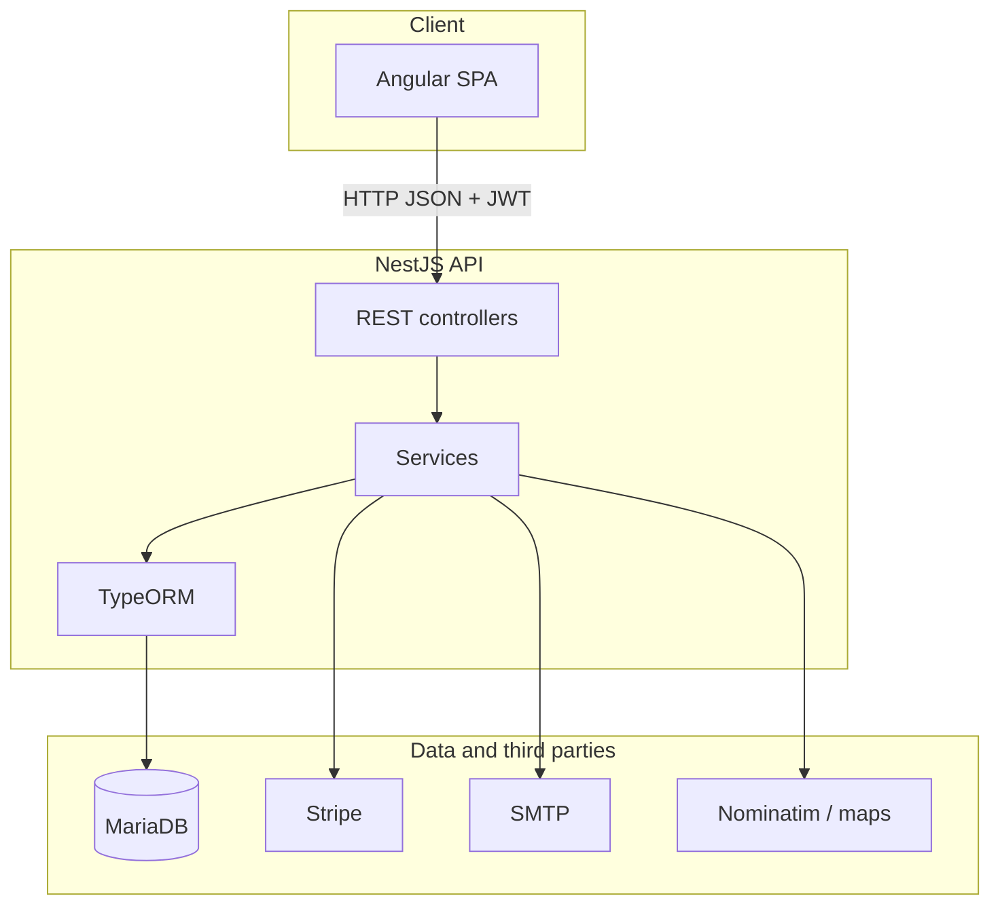

# FestivAll

**Discover events in Almería and buy tickets online.**

A full-stack ticketing platform for concerts and festivals in the province of Almería (rock, festivals, reggaeton, techno and more): browse and filter events, pay with Stripe, and manage the catalogue from an admin panel.

**Demo:** [https://festivall.club](https://festivall.club)

**Status:** Final degree project. Event content is fictional, and the live site still shows an in-development notice. Paid checkout uses Stripe (test or live keys, depending on configuration).

## Screenshots

| Home | Events | Brand |
| --- | --- | --- |
|  |  |  |

## Why

Finding local gigs and buying a ticket usually means jumping between social posts, venue pages and payment tools. FestivAll puts discovery, maps, checkout and ticket delivery in one place, with a separate admin area for the people who run the events.

## Features

- Home page of popular events, plus a searchable, filterable catalogue
- Event pages with photos, location on a Leaflet map (Nominatim geocoding) and reviews
- Paid tickets through Stripe Checkout, and a free-ticket path when no payment is needed
- QR tickets and a PDF download after purchase
- Email verification, password reset and change-password (SMTP)
- User profile with purchase history
- Reviews, with eligibility rules and admin moderation
- Admin panel (`/festivall-admin`) for events, users, clients, tickets, till close and review moderation
- Dynamic XML sitemap for SEO

## Tech stack

| Layer | Technology |
| --- | --- |
| Frontend | Angular 19 (SPA), Leaflet, jsPDF, QR Code |
| API | NestJS 11, TypeORM, Swagger/OpenAPI, Passport JWT |
| Database | MariaDB 11 |
| Payments | Stripe Checkout (test or live mode) |
| Mail | SMTP (e.g. the domain mailbox) |
| Images | Local uploads, processed with Sharp |
| Tests | Jest (API), Jasmine/Karma (Angular), k6 load tests |
| Deploy | Docker Compose, nginx, Let's Encrypt, documented for AWS EC2 |

## Architecture



In Docker, nginx serves the compiled Angular app and proxies `/api/` to NestJS. Auth uses a JWT stored by the client. Paid orders create a Stripe Checkout session; a `checkout.session.completed` webhook confirms the purchase in the database. Longer write-ups, including auth and payment sequence diagrams, are in [docs/ARCHITECTURE.md](docs/ARCHITECTURE.md) (Spanish).

## Project structure

```
FestivAll/
├── backend/                 # NestJS REST API (+ Dockerfile)
├── frontend/                # Angular SPA (+ Dockerfile + nginx)
├── database/                # schema.sql, seed.sql and incremental migrations
├── docs/                    # Architecture, testing, Stripe and user guides
├── load-tests/              # k6 smoke and load scripts
├── docker-compose.yml       # Production stack (MariaDB + API + web)
└── docker-compose.dev.yml   # MariaDB only, for local development
```

## Run locally

**Requirements:** Node.js 20+ and Docker (or a local MariaDB 10+/11).

### Full stack with Docker

```bash
cp .env.example .env
# Set JWT_SECRET, DB_PASSWORD, APP_PORT and, if you need payments, the Stripe variables

docker compose up -d --build
```

Open **http://localhost** (or the port set in `APP_PORT`). On port 80, nginx serves the app for `localhost` over HTTP. The `festivall.club` server block redirects to HTTPS and expects Let's Encrypt certificates, which you do not need for a local run.

| Service | Container | Role |
| --- | --- | --- |
| `frontend` | `festivall-web` | Built Angular app + nginx (`APP_PORT`, default 80) |
| `backend` | `festivall-api` | NestJS in production mode |
| `mariadb` | `festivall-db` | Database, initialised from `schema.sql` and `seed.sql` |

The admin user is **not** created automatically when Docker restarts. Create it once with the seed script below.

```bash
docker compose ps
docker compose logs -f
docker compose down          # stop
docker compose down -v       # stop and wipe the database volume
```

Stripe variables can live in the root `.env` or in `backend/.env`. Compose loads both; if a variable is set twice, `backend/.env` wins.

### Development (hot reload)

**1. Database** — MariaDB only:

```bash
docker compose -f docker-compose.dev.yml up -d
```

Or a local client:

```bash
mysql -u root -p < database/schema.sql
mysql -u root -p < database/seed.sql
```

**2. Backend**

```bash
cd backend
cp .env.example .env
# Point it at your MariaDB credentials
npm install
npm run start:dev
```

Create the admin user:

```bash
cd backend
npm run seed:admin
```

The script prints the initial credentials the first time it creates the account. Change that password before any real deployment.

Swagger UI is on **http://localhost:3000/docs** while `SWAGGER_ENABLED` is not `false`. In the production compose file it defaults to `false`; set `SWAGGER_ENABLED=true` if you need it behind nginx at `/api/docs`.

**3. Frontend**

```bash
cd frontend
npm install
npm start
```

Open http://localhost:4200. The dev server proxies `/api` to `localhost:3000` (see `proxy.conf.json`). Restart `npm start` after changing the proxy config.

> **WSL + Windows:** that proxy avoids connection issues between the two sides.

## Deploy

The same `docker compose up -d --build` is what production uses. The frontend image listens on 80 and 443 and can mount Let's Encrypt certificates, as in [frontend/nginx.conf](frontend/nginx.conf).

A step-by-step AWS EC2 guide (Ubuntu, Docker, DNS, TLS) is in [`docs/EC2-deployment.md`](docs/EC2-deployment.md) (Spanish).

Set a strong `JWT_SECRET` and database password, keep Stripe in test mode until you are ready, and do not commit `.env`.

## Tests

| Kind | Guide |
| --- | --- |
| Unit tests (Jest / Jasmine + Karma) | [docs/TESTING.md](docs/TESTING.md) |
| Load / stress (k6) | [docs/LOAD_TESTING.md](docs/LOAD_TESTING.md) — scripts in `load-tests/` |

```bash
cd backend && npm test
cd frontend && npm test          # Chrome, watch mode
cd frontend && npm run test:ci   # headless, for CI or a server
```

The backend also has `npm run test:e2e`. The file in `backend/test/` is still the NestJS starter (“Hello World!”) and does not yet exercise FestivAll routes.

k6 smoke and load scripts hit public GET endpoints only (events, catalogue). Prefer the local stack, not production:

```bash
./load-tests/run-local-smoke.sh
# or, with the API running on port 3000 and no nginx prefix:
BASE_URL=http://127.0.0.1:3000 API_PREFIX="" k6 run load-tests/k6-smoke.js
```

The smoke/load helpers use `DOCKER_NETWORK` (default `festivall_festivall-net`). Override if your Compose project name differs: `DOCKER_NETWORK=myproject_festivall-net ./load-tests/run-local-smoke.sh`.

## Payments (Stripe)

Paid events use **Stripe Checkout**. Full setup: [docs/STRIPE.md](docs/STRIPE.md) (Spanish).

Short version: a Stripe account (test mode) ‚Üí keys in `.env` ‚Üí migration `database/migrations/002_stripe_checkout.sql` ‚Üí Stripe CLI webhook in local development.

## Main routes

| Route | Description |
| --- | --- |
| `/login`, `/register` | User sign-in and registration |
| `/verificar-email`, `/olvidar-contrasena` | Email verification and password reset |
| `/` | Home (popular events) |
| `/eventos` | Catalogue with search and filters |
| `/eventos/:slug` | Event detail and ticket purchase |
| `/mapa` | Map search |
| `/opiniones` | Reviews |
| `/perfil` | Profile, purchase history and password change |
| `/compras/exito` | Post-payment confirmation |
| `/festivall-admin` | Admin login |
| `/festivall-admin/panel` | Admin: events, users, clients, tickets and reviews |

## Docs

| Resource | Description |
| --- | --- |
| [docs/DOCUMENTATION.md](docs/DOCUMENTATION.md) | How to generate Swagger and Compodoc (Spanish) |
| [docs/ARCHITECTURE.md](docs/ARCHITECTURE.md) | Modules and auth/payment flows (Spanish) |
| [docs/STRIPE.md](docs/STRIPE.md) | Stripe configuration (Spanish) |
| [docs/TESTING.md](docs/TESTING.md) | Unit-test guide (Spanish) |
| [docs/LOAD_TESTING.md](docs/LOAD_TESTING.md) | k6 load-test guide (Spanish) |
| [docs/GUIA_ESTILOS_FRONTEND.md](docs/GUIA_ESTILOS_FRONTEND.md) | Frontend style guide (Spanish) |
| [docs/guia-uso-cliente.pdf](docs/guia-uso-cliente.pdf) | End-user guide (Spanish, PDF) |
| [docs/guia-uso-admin.pdf](docs/guia-uso-admin.pdf) | Admin guide (Spanish, PDF) |
| OpenAPI | Local: `http://localhost:3000/docs` · behind nginx: `/api/docs` (enable with `SWAGGER_ENABLED=true`) |
| Compodoc | `cd frontend && npm run doc` ‚Üí `frontend/documentation/` |

## Authors

Final degree project by [Agustín Rubí Hernández](https://github.com/AgustinRH) and [Rafael Pablo García Sánchez](https://github.com/RafaelGarcia-02).

## License

MIT ó see [LICENSE](LICENSE). Copyright (c) 2026 AgustÌn RubÌ Hern·ndez and Rafael Pablo GarcÌa S·nchez.

