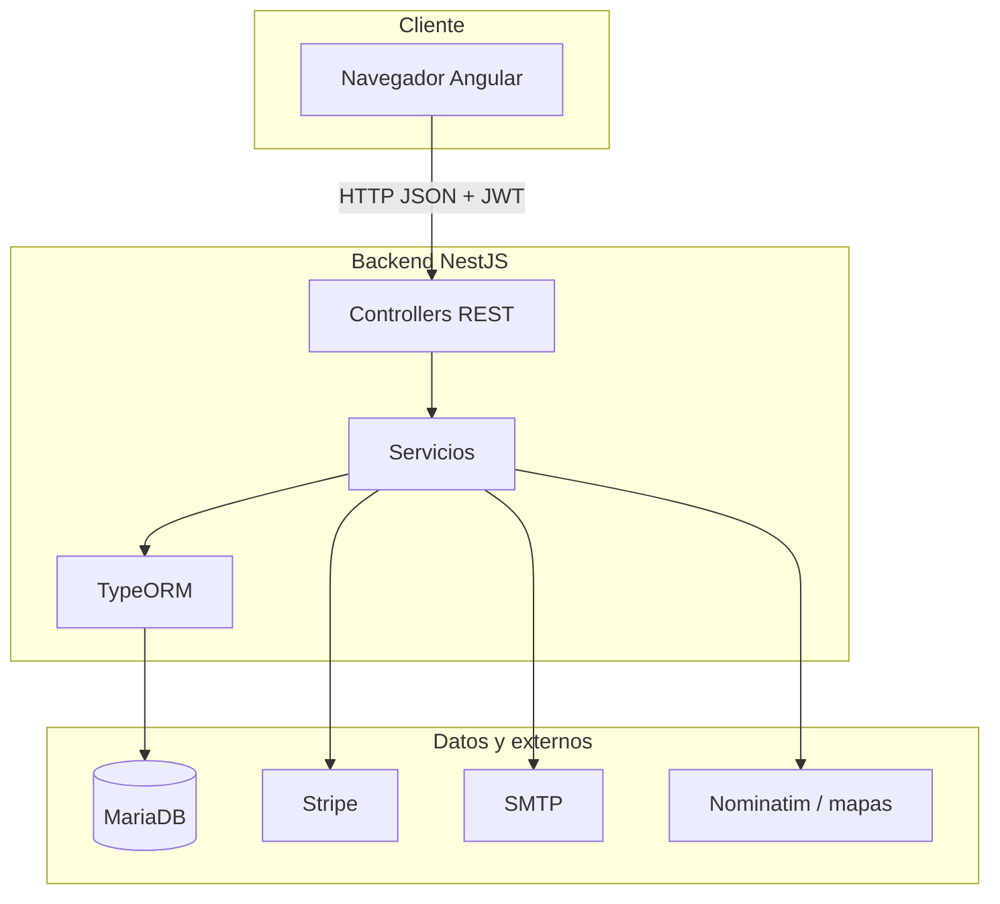
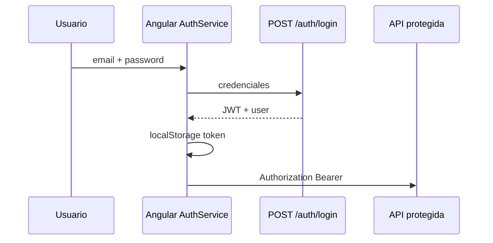
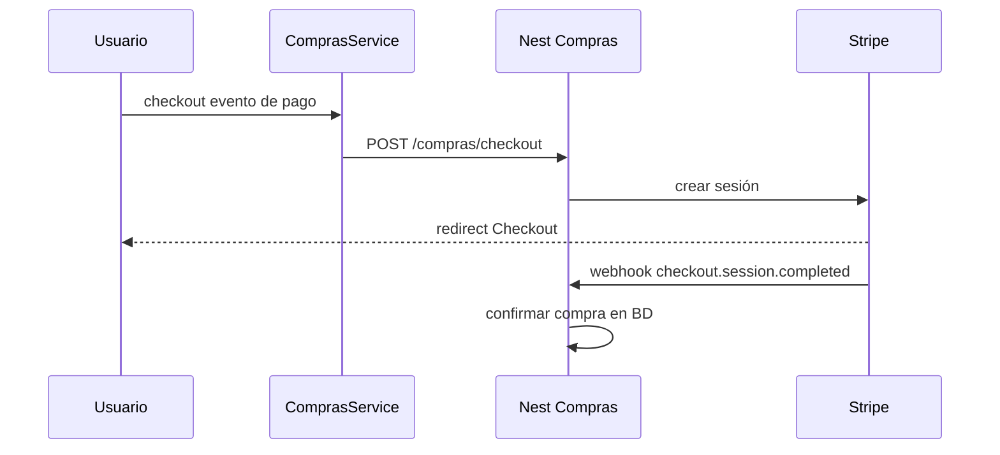

# Arquitectura FestivAll

## Vista general

## Módulos backend

| Módulo | Responsabilidad |
|--------|-----------------|
| `AuthModule` | Registro, login, JWT, verificación email, contraseñas |
| `EventosModule` | CRUD eventos, imágenes, mapa, geocodificación |
| `ComprasModule` | Checkout Stripe, entradas gratis, webhook, admin entradas |
| `ValoracionesModule` | Opiniones, moderación, elegibilidad |
| `CatalogoModule` | Categorías y ubicaciones |
| `UsuariosModule` / `ClientesModule` | Administración |
| `SitemapModule` | XML SEO |

## Capas frontend

| Capa | Ubicación | Rol |
|------|-----------|-----|
| Páginas | `src/app/pages/` | Rutas y pantallas |
| Compartidos | `src/app/shared/` | Navbar, cards, formularios reutilizables |
| Core | `src/app/core/` | Servicios HTTP, guards, modelos, utils |
| Entornos | `src/environments/` | URL de API |

## Autenticación

## Compra de entradas (pago)

## Documentación generada

| Herramienta | Salida | Contenido |
|-------------|--------|-----------|
| Swagger | `http://localhost:3000/api/docs` | Endpoints, DTOs, auth JWT |
| Compodoc | `frontend/documentation/` | Componentes, servicios, diagramas |
| TSDoc en código | — | Lógica compleja en utils/servicios |
